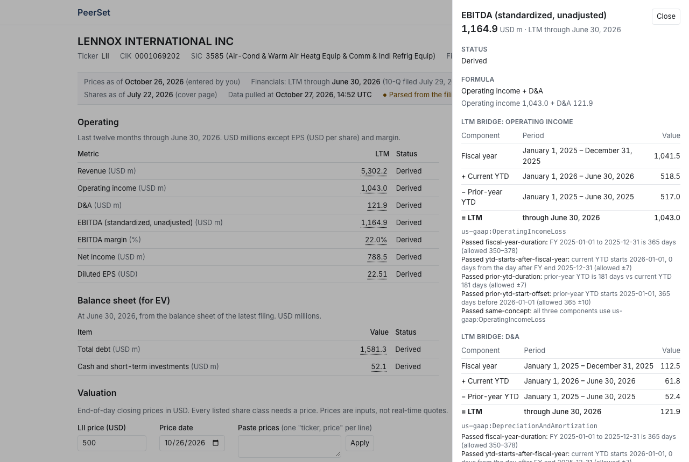

# PeerSet

[](https://github.com/jihomoon1/peerset/actions/workflows/ci.yml)
[](https://github.com/jihomoon1/peerset/actions/workflows/smoke.yml)

PeerSet turns a U.S. stock ticker into the first pass of a trading-comparables analysis, built straight from the company's SEC filings. Every number links back to the filing, period and XBRL concept it came from, so you can check it rather than trust it.

It is a free, open-source, non-commercial student project. Its output is standardized and unadjusted: **automated first-pass comps from SEC filings, not a substitute for analyst review.**

**Live:** [peerset.vercel.app](https://peerset.vercel.app) · try [LII](https://peerset.vercel.app/c/LII)



_Lennox International, LTM through June 30, 2026 (10-Q filed July 29, 2026), from the frozen test fixture. The 500.00 share price is an illustrative user-entered input, not a market quote._

## What works now

For one company at a time:

- **LTM operating metrics:** revenue, operating income, D&A, EBITDA (standardized, unadjusted), EBITDA margin, net income and diluted EPS. LTM is built as fiscal year + current year-to-date − prior year-to-date, with date checks that cover 52/53-week and non-December fiscal years.
- **Filing freshness:** PeerSet checks that it is using the latest 10-K or 10-Q, and parses the filing's XBRL itself when SEC's summary API hasn't caught up yet.
- **Debt and cash from the balance sheet as presented:** the lines the company shows on the face of its balance sheet, classified by rule. Operating leases are never debt, and an unrecognized debt line makes debt Unsupported rather than guessed.
- **Share classes:** shares outstanding by class from the filing's cover page, each class mapped to its own listed ticker.
- **User-entered prices:** you type the closing price and its date; nothing is fetched from a price vendor.
- **EV and multiples:** market cap, enterprise value, EV/Revenue, EV/EBITDA and P/E, with explicit NM rules (negative denominators, EV ≤ 0, above 100x).
- **Per-cell provenance:** click any figure to see its formula, inputs, XBRL concept, period, accession number and a link to the filing.

Every value carries a status (Reported, Derived, NM, Missing or Unsupported). **Missing is never shown as zero.**

## Coming next

- Peer suggestions, a comps table and summary statistics (mean, median, high, low)
- Excel export of the same analysis

## How the numbers are verified

- Golden tests run the pipeline on frozen SEC filings and check results to the dollar: LTM metrics and valuation for LII and WSO, and balance-sheet debt and cash for LII, WSO, GGG, AAON, Carrier and Trane.
- Each golden company has a reconciliation table comparing PeerSet to the filing itself, row by row: [`docs/reconciliation/`](docs/reconciliation/) ([LII](docs/reconciliation/LII.md), [WSO](docs/reconciliation/WSO.md)).
- Golden values change only with a written reconciliation note saying why (new filing, definition change or bug), never to make a test pass.
- Every financial definition is written down in [`docs/methodology.md`](docs/methodology.md) (version 0.3.5).

Green CI means the code builds and the tests pass. It is not proof the numbers are right; the reconciliation tables are.

## Data sources and licensing

- **Financial data:** SEC EDGAR filings and APIs, which are public. PeerSet identifies itself to SEC with a contact User-Agent and stays well under SEC's fair-access limits.
- **Prices:** entered by you. Free price APIs don't permit display on a public website, so PeerSet doesn't redistribute vendor prices. It will use Alpha Vantage end-of-day closes only if written permission is granted. Details: [`docs/licensing.md`](docs/licensing.md).

## Known limitations

- EBITDA is standardized and unadjusted; company-reported adjusted EBITDA will differ.
- Shares are basic (cover page), not diluted by the treasury stock method, so equity value runs below a banker's figure.
- EV leaves out preferred stock, noncontrolling interests and equity investments; PeerSet warns when they look material.
- Prices are user-entered; there are no historical prices.
- Only U.S. 10-K/10-Q filers reporting in USD; no 20-F filers, ADRs or financial companies (SIC 6000–6799).
- Company-specific XBRL extension tags are ignored, so some companies come out Unsupported.
- Multi-class P/E and unlisted share classes are Unsupported.
- LTM is only as current as the company's latest filing.
- SEC's APIs can behave in undocumented ways; the known lag in SEC's summary data is handled, and others may exist.

## Run it locally

Requires Node.js 24 (see `.nvmrc`).

```bash
npm install
cp .env.example .env.local   # then set SEC_USER_AGENT="PeerSet (Your Name) <your email>"
npm run dev                  # open http://localhost:3000
```

Checks: `npm run typecheck`, `npm run lint`, `npm test`, `npm run build`. End-to-end tests run on frozen SEC fixtures, never live SEC: `npx playwright install chromium`, then `npm run build && npm run e2e`.

## Tech stack

Next.js 16 and React 19 in TypeScript on Vercel, Tailwind CSS, Zod, Vitest, Playwright with axe, and GitHub Actions.

## License

[MIT](LICENSE) © 2026 Jiho Moon
