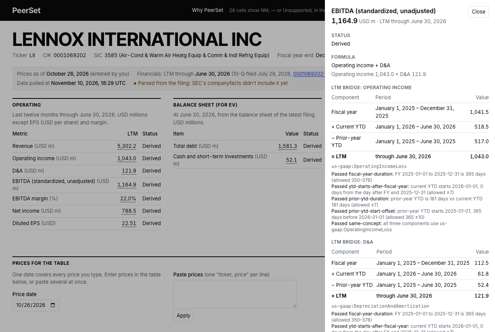
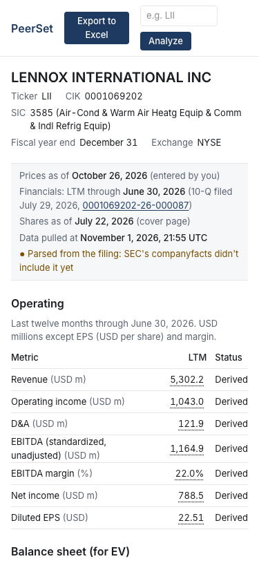

# PeerSet

[](https://github.com/jihomoon1/peerset/actions/workflows/ci.yml)
[](https://github.com/jihomoon1/peerset/actions/workflows/smoke.yml)

PeerSet turns a U.S. stock ticker into the first pass of a trading-comparables analysis, built straight from the company's SEC filings. Every number links back to the filing, period and XBRL concept it came from, so you can check it rather than trust it.

It is a free, open-source, non-commercial student project. Its output is standardized and unadjusted: **automated first-pass comps from SEC filings, not a substitute for analyst review.**

**Live:** [peerset.vercel.app](https://peerset.vercel.app)

**Demo:** [LII with test prices](https://peerset.vercel.app/c/LII?cik=0001069202&add=TT,WSO&px=LII:500,CARR:60,AAON:100,TT:400,WSO:450,WSO-B:450,JCI:80). The prices in this link are **test inputs** (the same ones the comps golden test uses), not market quotes. Live peers without a test price show "—" and stay out of the statistics.



_Lennox International, LTM through June 30, 2026 (10-Q filed July 29, 2026), from the frozen test fixture. The 500.00 share price is an illustrative user-entered input, not a market quote._



## What it does

1. **Look up a ticker.** PeerSet shows who it belongs to (name, CIK, exchange, latest filing) and whether it can be analyzed.
2. **LTM financials:** revenue, operating income, D&A, EBITDA (standardized, unadjusted), EBITDA margin, net income and diluted EPS, built as fiscal year + current year-to-date − prior year-to-date, with date checks for 52/53-week and non-December years.
3. **Balance sheet as presented:** debt and cash come from the lines the company shows on its balance sheet, classified by rule. An unrecognized debt line makes debt Unsupported rather than guessed.
4. **Peers:** screened from a monthly index of SEC registrants by industry code (SIC) and a 0.2x–5x revenue band. Each peer says why it was chosen; you can add or remove peers.
5. **Valuation:** market cap by share class, enterprise value, EV/Revenue, EV/EBITDA and P/E, with explicit NM rules, summary statistics over peers (mean, median, quartiles, high, low, n) and an implied price range.
6. **Excel export:** the same snapshot as a three-sheet workbook with live formulas and a Sources sheet linking every filing.
7. **Provenance:** click any figure to see its formula, inputs, XBRL concept, period, accession number and a link to the filing.

Every value carries a status (Reported, Derived, NM, Missing or Unsupported). **Missing is never shown as zero.** Analyses are shareable by link; nothing is stored on a server.

## How the numbers are verified

- **Golden tests** run the pipeline on frozen SEC filings for 8 companies (LII, WSO, GGG, AAON, Carrier, Trane, JCI, Lucid) and check results to the dollar (`tests/golden/`).
- **Reconciliation tables** compare PeerSet to the rendered filing, row by row: [`docs/reconciliation/`](docs/reconciliation/) ([LII](docs/reconciliation/LII.md), [WSO](docs/reconciliation/WSO.md), [GGG](docs/reconciliation/GGG.md), [JCI](docs/reconciliation/JCI.md), [LCID](docs/reconciliation/LCID.md), [comps golden](docs/reconciliation/comps-golden.md)).
- Golden values change only with a written reconciliation note saying why (new filing, definition change or bug), never to make a test pass.
- **Methodology:** every financial definition is written down in [`docs/methodology.md`](docs/methodology.md) (version 0.4.3) and shown on the site at [/methodology](https://peerset.vercel.app/methodology).
- **Tests:** unit, golden, integration and workbook tests (Vitest), plus browser tests with accessibility checks (Playwright and axe). CI never calls live SEC. See [`tests/README.md`](tests/README.md).

Green CI means the code builds and the tests pass. It is not proof the numbers are right; the reconciliation tables are.

## Data sources and licensing

- **Financial data:** SEC EDGAR filings and APIs, which are public. PeerSet identifies itself to SEC with a contact User-Agent and stays well under SEC's fair-access limit.
- **Prices:** entered by you. No free price API permits display on a public website. Alpha Vantage was asked for written permission and declined on October 28, 2026, so PeerSet never fetches or redistributes vendor prices. Details: [`docs/licensing.md`](docs/licensing.md).

## Known limitations

- EBITDA is standardized and unadjusted; company-reported adjusted EBITDA will differ.
- D&A is the filing's reported D&A tag, usually from the cash-flow statement (sometimes a note), and may include items outside operating expenses. When a period has discontinued operations, D&A may include them (flagged with a caution).
- Shares are basic (cover page), not diluted by the treasury stock method, so equity value runs below a banker's figure.
- EV leaves out preferred stock, noncontrolling interests and equity investments; PeerSet warns when they look material. Preferred stock or noncontrolling interest held in temporary equity is classified by its label; when PeerSet still can't classify the item, it names the temporary-equity line in a caution instead (Lucid's $2.9 billion of redeemable convertible preferred is the known case).
- Peers come from SIC codes and revenue scale, not economic judgment.
- Prices are user inputs: typed, or filled by your own browser with your own free Alpha Vantage key (PeerSet never sees the key). There are no historical prices.
- Only U.S. 10-K/10-Q filers reporting in USD; no 20-F filers, ADRs or financial companies (SIC 6000–6799).
- Company-specific XBRL extension tags are ignored, so some companies come out Unsupported. Lucid, for example, tags its cash-flow D&A with its own concept, so PeerSet uses the standard D&A tag from its notes instead (a $30,000 difference).
- Multi-class P/E and unlisted share classes are Unsupported.
- LTM is only as current as each company's latest filing; laggards are flagged, not fixed.
- SEC's APIs can behave in undocumented ways; the known lag in SEC's summary data is handled, and others may exist.

Future work (blueprint §24): diluted shares, preferred/NCI EV adjustments, a football-field chart, alternative screens, quarterly trends, and 20-F support.

## Interview pack

[`docs/interview/`](docs/interview/): product summary, architecture, methodology cheat sheet, two-minute demo script, four problems and how they were solved, and the decision log. Design decisions are recorded in [`docs/decisions/`](docs/decisions/).

## Run it locally

Requires Node.js 24 (see `.nvmrc`).

```bash
npm install
cp .env.example .env.local   # then set SEC_USER_AGENT="PeerSet (Your Name) <your email>"
npm run dev                  # open http://localhost:3000
```

Checks: `npm run typecheck`, `npm run lint`, `npm test`, `npm run build`. End-to-end tests run on frozen SEC fixtures, never live SEC: `npx playwright install chromium`, then `npm run build && npm run e2e`.

## Tech stack

Next.js 16 and React 19 in TypeScript on Vercel, Tailwind CSS, Zod, ExcelJS, marked, Vitest, Playwright with axe, and GitHub Actions.

## License

[MIT](LICENSE) © 2026 Jiho Moon. Changes: [`CHANGELOG.md`](CHANGELOG.md).
