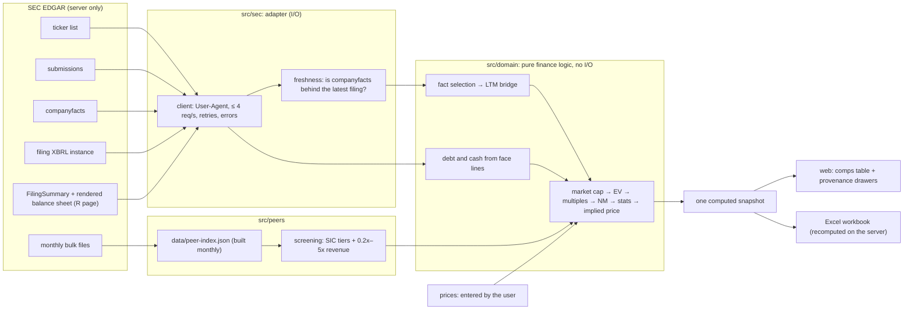

# Architecture

One Next.js app with three layers. The **adapter** (`src/sec`) does all network work: it resolves the ticker, reads the company's submissions to find its latest 10-K or 10-Q, and pulls SEC's companyfacts. When companyfacts hasn't caught up with that filing yet, it parses the filing's own XBRL instance and marks those values. For debt and cash, it reads the balance sheet the company actually presents (the FilingSummary's rendered statement) to learn which lines are on the face, then takes their values from the XBRL instance. The **domain** (`src/domain`) is pure TypeScript with no network, clock or environment access, so every rule is unit-tested by feeding it facts and dates: LTM construction, EBITDA, the EV bridge, the NM policy and the statistics. Peers come from a committed index built monthly from SEC's bulk files, so screening a ticker makes no SEC calls. Prices come from the user, so no vendor license is involved. The web table and the Excel export render the same snapshot, and the export route recomputes it on the server instead of trusting numbers sent by the browser. The browser never calls SEC.
